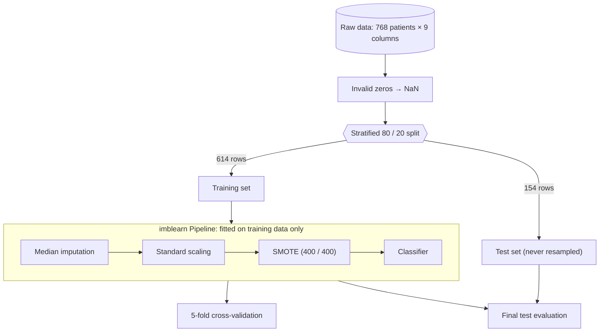
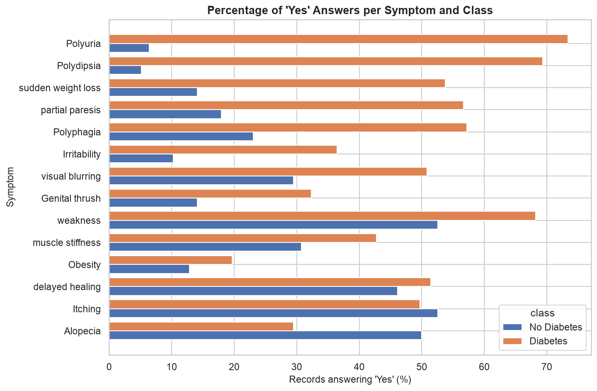
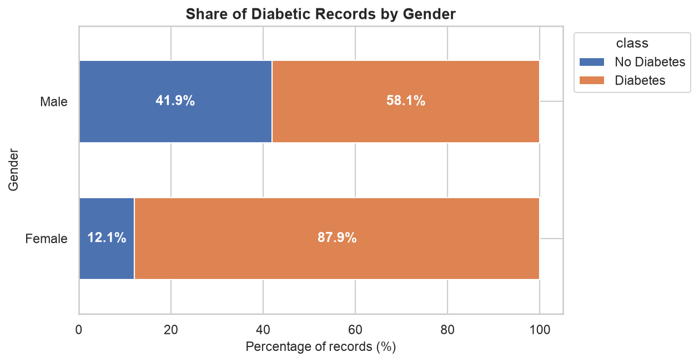
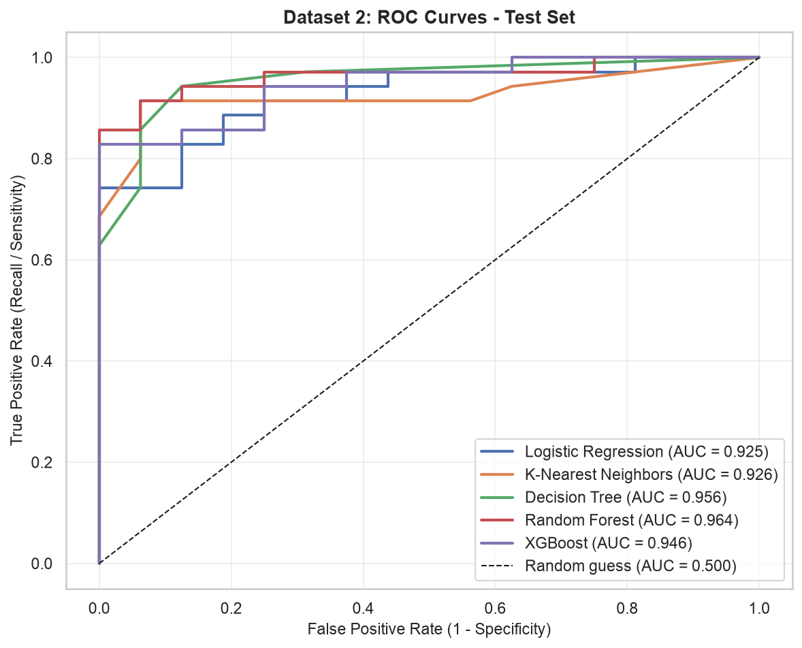
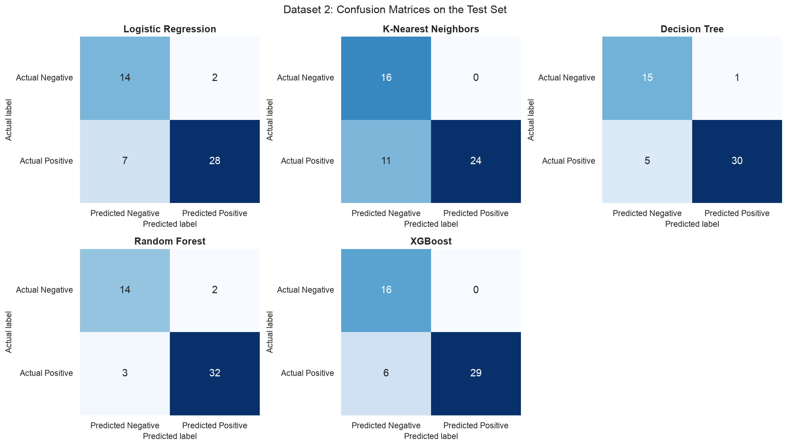
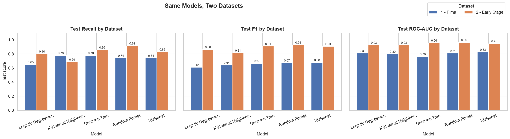
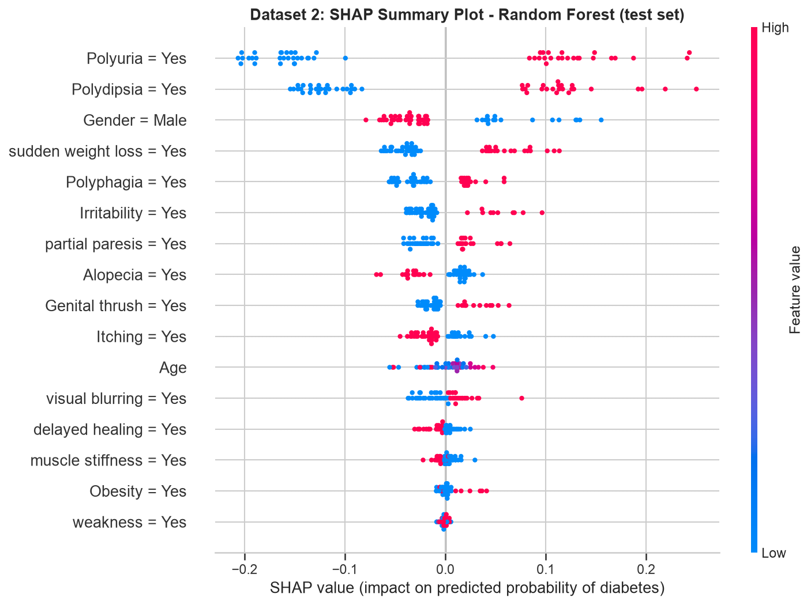

<div align="center">

# 🩺 Diabetes Onset Prediction Using Machine Learning

**An end-to-end Predictive Analytics / KDD project that estimates diabetes risk from clinical measurements (Pima) and from self-reported symptoms (UCI Early Stage dataset)**

[](https://colab.research.google.com/github/hardikjain2005/-Predictive-Analytics-CA-3-Diabetes-Onset-Prediction-Using-Machine-Learning/blob/main/notebooks/Diabetes_Onset_Prediction.ipynb)

[](https://www.python.org/)
[](notebooks/Diabetes_Onset_Prediction.ipynb)
[](https://scikit-learn.org/)
[](https://xgboost.readthedocs.io/)
[](https://shap.readthedocs.io/)
[](https://imbalanced-learn.org/)
[](LICENSE)

**Hardik Jain** · Student ID **23070521056** · Predictive Analytics (CA-3)

</div>

> [!IMPORTANT]
> This is an **academic project**. The model is **not** a medical diagnostic system and must not be used to make clinical decisions.

---

## ⚡ At a Glance

🎯 **Task:** binary classification, *will this person have diabetes?*, on **two related but separate datasets**. They have different features and populations, so they are **not merged**: each is modelled separately with the same evaluation philosophy, and only the results are compared.

| | Dataset 1 – Pima Indians Diabetes | Dataset 2 – Early Stage Diabetes Risk (UCI) |
|---|---|---|
| 📊 **Data** | 768 patients, 8 clinical measurements, 35 % diabetic | 520 questionnaire records → **251 unique**, Age + Gender + 14 Yes/No symptoms, 69 % diabetic |
| 🧹 **Key challenge** | Hidden missing values as impossible **zeros** (Insulin 48.7 %) | **52 % exact duplicate rows** (would leak into the test set) |
| 🛡️ **Pipeline** | median imputation → scaling → **SMOTE** (training data only) | imputation → scaling → **one-hot encoding** (training data only) |
| 🤖 **Models** | LR · KNN · Decision Tree · Random Forest · XGBoost | same five, same settings |
| 🏆 **Final model** (same recall-aware rule) | **Random Forest**: recall **0.741**, ROC-AUC **0.809** (CV 0.829) | **Random Forest**: recall **0.914**, ROC-AUC **0.964** (CV 0.977) |
| 🔍 **Top predictors** (SHAP) | **Glucose**, BMI, Age, pedigree function | **Polyuria**, **Polydipsia**, Gender, sudden weight loss |

<p align="center">
  
</p>

---

## 📑 Table of Contents

- [Deliverables](#-deliverables)
- [Problem Statement & Objectives](#-problem-statement--objectives)
- [Datasets](#-datasets)
- [Methodology](#-methodology)
- [Exploratory Data Analysis](#-exploratory-data-analysis)
- [Models](#-models)
- [Results](#-results)
- [Dataset Comparison](#-dataset-comparison)
- [Model Interpretation](#-model-interpretation)
- [Try a Prediction](#-try-a-prediction)
- [Project Structure](#-project-structure)
- [Getting Started](#-getting-started)
- [Limitations & Future Scope](#-limitations--future-scope)
- [References](#-references)

---

## 📦 Deliverables

| Deliverable | File | Description |
|---|---|---|
| 📓 Jupyter Notebook | [`Diabetes_Onset_Prediction.ipynb`](notebooks/Diabetes_Onset_Prediction.ipynb) | Fully executed; 20 sections covering both datasets, with an explanation before every step |
| 🗃️ Datasets | [`data/`](data) | Both raw datasets plus the cleaned versions in `data/processed/` |
| 📄 Project Report | [`Diabetes_Onset_Prediction_Report.pdf`](Diabetes_Onset_Prediction_Report.pdf) | 6 chapters: Introduction, Literature Review, Workflow, Results, Conclusion, References (covers Dataset 1) |
| 🎤 Interactive Presentation | [`Diabetes_Onset_Prediction_Presentation .pptx`](Diabetes_Onset_Prediction_Presentation%20.pptx) | PowerPoint deck with clickable agenda and Model Explorer (covers Dataset 1) |
| 🧩 Source modules | [`src/`](src) | Reusable preprocessing, model and evaluation code for both datasets |
| 📈 Results | [`results/`](results) | Metric tables (CSV) and 29 generated figures |

---

## 🎯 Problem Statement & Objectives

Type 2 diabetes often develops slowly and can go unnoticed for years, and late detection increases the risk of complications. Hospitals already record simple measurements such as plasma glucose, BMI and blood pressure.

> **Problem:** Given a person's features **X**, predict whether they have diabetes (**1**) or not (**0**) and estimate the probability of diabetes, so that higher-risk individuals can be **flagged for proper clinical testing**. This is done for two datasets: clinical measurements (Pima) and self-reported symptoms (UCI Early Stage).

**Objectives**

1. Identify and correct hidden data-quality problems.
2. Explore how each measurement relates to the outcome.
3. Build a reproducible pipeline that **never leaks test data into training**.
4. Compare five algorithms using metrics suited to an **imbalanced screening** problem.
5. Choose a final model with a transparent, recall-aware rule, not accuracy alone.
6. Explain the models' behaviour with **feature importance** and **SHAP**.
7. **Compare the two datasets**: which is easier to predict, which features matter, and whether the models behave consistently.

---

## 🗂 Datasets

### Dataset 1 – Pima Indians Diabetes

**Pima Indians Diabetes Dataset.** It was originally collected by the US National Institute of Diabetes and Digestive and Kidney Diseases. All 768 subjects are females of Pima Indian heritage aged 21 or older.
Source: [jbrownlee/Datasets](https://github.com/jbrownlee/Datasets/blob/master/pima-indians-diabetes.data.csv), stored with a header row at [`data/pima-indians-diabetes.csv`](data/pima-indians-diabetes.csv). The observations themselves are unchanged.

| Feature | Description | Unit |
|---|---|---|
| Pregnancies | Number of times pregnant | count |
| Glucose | Plasma glucose, 2 h oral glucose tolerance test | mg/dL |
| BloodPressure | Diastolic blood pressure | mm Hg |
| SkinThickness | Triceps skin-fold thickness | mm |
| Insulin | 2-hour serum insulin | µU/mL |
| BMI | Body-mass index | kg/m² |
| DiabetesPedigreeFunction | Score of diabetes history in relatives | – |
| Age | Age | years |
| **Outcome** | **Target: 0 = no diabetes, 1 = diabetes** | class |

### 🧹 Hidden missing values

The raw file reports **no missing values**, but five columns contain physiologically impossible **zeros**. These are treated as missing (NaN):

| Feature | Invalid zeros | % of rows |
|---|---:|---:|
| Glucose | 5 | 0.65 % |
| BloodPressure | 35 | 4.56 % |
| SkinThickness | 227 | 29.56 % |
| Insulin | 374 | **48.70 %** |
| BMI | 11 | 1.43 % |

Dropping incomplete rows would discard almost half the data, so the missing values are **imputed with the training-set median** instead.

### Dataset 2 – Early Stage Diabetes Risk Prediction

**Source:** [UCI Machine Learning Repository, dataset 529](https://archive.ics.uci.edu/dataset/529/early+stage+diabetes+risk+prediction+dataset), DOI [10.24432/C5VG8H](https://doi.org/10.24432/C5VG8H), licensed **CC BY 4.0**. The data come from direct questionnaires with patients of Sylhet Diabetes Hospital, Bangladesh, and were introduced by Islam *et al.* (2019). The notebook **downloads it automatically** from UCI and stores it as [`data/early_stage_diabetes_risk_prediction.csv`](data/early_stage_diabetes_risk_prediction.csv). The file is also kept in this repository as a fallback.

| Feature(s) | Type |
|---|---|
| Age | numeric (years) |
| Gender | Male / Female |
| Polyuria, Polydipsia, sudden weight loss, weakness, Polyphagia, Genital thrush, visual blurring, Itching, Irritability, delayed healing, partial paresis, muscle stiffness, Alopecia, Obesity | Yes / No symptoms |
| **class** (target, detected automatically) | **Positive = 1, Negative = 0** |

### 🧹 Hidden duplicates

The file has no missing values, but **269 of its 520 rows (51.7 %) are exact duplicates**. No duplicate group has conflicting labels. With a random split, copies of the same record would end up in **both** the training and the test set, so the model would be tested on records it has already seen. The notebook therefore **removes exact duplicates before splitting** (251 unique records: 173 positive, 78 negative). This is a fixed rule that learns nothing from the data, so it cannot leak. The [Dataset Comparison](#-dataset-comparison) section shows how much the duplicates would have inflated the scores.

---

## 🛠 Methodology

The project follows the **KDD process**: Problem Definition → Data Selection → Data Understanding → Data Cleaning → Data Transformation → EDA → Model Construction → Evaluation → Interpretation → Knowledge.

### 🛡️ Leak-free modelling pipeline



**Why this design?**

* **The split comes first.** Medians, scaling statistics and synthetic SMOTE samples are learned **only from training data**, so the test set stays truly unseen.
* **SMOTE sits inside the pipeline.** During cross-validation it is re-applied to each training fold only, never to the validation fold.
* **Imbalance handling pays off.** Without it, Logistic Regression's cross-validated recall drops to **0.57**. With SMOTE it rises to **0.72**, while ROC-AUC stays essentially the same.
* **Reproducible.** `random_state = 42` everywhere; repeated runs produce byte-identical results.

**Dataset 2** follows the same principles with a pipeline suited to its data:

* The target column is **identified automatically** (`class`) and encoded to 1 / 0. Numeric and categorical features are detected from their types; nothing assumes the Pima columns.
* Text is cleaned with fixed rules (spaces, Yes/No spelling, "unknown"-style tokens → NaN), and exact duplicates are removed.
* A **stratified 80/20 split** (200 / 51 records) comes **before** a `ColumnTransformer` that is fitted inside each model's pipeline: Age → median imputation + scaling; categories → most-frequent imputation + one-hot encoding.
* **No SMOTE.** The features are 0/1 answers, which SMOTE would turn into impossible values such as `Polyuria = 0.37`. Class weights were tested with cross-validation on the training data and **lowered recall** (0.878 vs 0.907), because here the minority class is the *non-diabetic* class. So no re-weighting is used.

---

## 🔬 Exploratory Data Analysis

<p align="center">
  
  
</p>

| Insight | Evidence |
|---|---|
| 🍬 **Glucose separates the classes best** | Median 140 vs. 107 mg/dL; correlation with Outcome **0.49** |
| ⚖️ **BMI is higher in diabetic patients** | Median 34.3 vs. 30.1 kg/m²; r = 0.31 |
| 🎂 **Diabetic patients tend to be older** | Median age 36 vs. 27 years |
| 🔗 **Moderate feature correlations** | SkinThickness–BMI 0.65, Glucose–Insulin 0.58: no feature needs to be removed |
| 🌫️ **Every feature overlaps between classes** | No single measurement is enough, so a multivariate model is needed |

**Dataset 2**

<p align="center">
  
  
</p>

| Insight | Evidence |
|---|---|
| 🚰 **Polyuria and Polydipsia separate the classes strongly** | 73 % / 69 % of diabetic records vs 6 % / 5 % of non-diabetic records; association with class ≈ 0.6 |
| ⚖️ **Sudden weight loss, partial paresis, Polyphagia** | Also much more common among diabetic records |
| 🚻 **Gender** | 88 % of the women's records are diabetic vs 58 % of the men's (a property of this hospital sample) |
| 🎂 **Age matters little here** | Median 49 vs 46.5 years |

*These are statistical associations in these samples, not causal effects.*

---

## 🤖 Models

| Model | Paradigm | Configuration |
|---|---|---|
| Logistic Regression | Linear, interpretable baseline | `max_iter=1000` |
| K-Nearest Neighbors | Instance-based (distance) | `n_neighbors=15` |
| Decision Tree | Rule-based tree | `max_depth=5`, `min_samples_leaf=5` |
| Random Forest | Bagging ensemble | `n_estimators=300`, `min_samples_leaf=2` |
| XGBoost | Gradient boosting | `n_estimators=200`, `max_depth=3`, `learning_rate=0.05`, `subsample=0.8`, `colsample_bytree=0.8` |

The **same five models with the same settings** are used for both datasets, so their behaviour can be compared. All models are evaluated on **Accuracy, Precision, Recall, F1 and ROC-AUC**, plus specificity, confusion matrices, ROC curves and 5-fold cross-validation on the training data.
**Recall** gets special attention: in screening, a missed diabetic patient (false negative) is costlier than a false alarm, which would lead to a follow-up test.

---

## 📊 Results

> All numbers below come from executing the notebook and are saved in [`results/`](results): `model_comparison.csv` and `metrics.csv` (Dataset 1), `early_stage_model_comparison.csv` and `early_stage_metrics.csv` (Dataset 2), and `dataset_comparison.csv` (both).

### Dataset 1 – Pima: hold-out test set (154 patients, sorted by ROC-AUC)

| Model | Accuracy | Precision | Recall | F1 | ROC-AUC |
|---|---:|---:|---:|---:|---:|
| XGBoost | 0.7532 | 0.6250 | 0.7407 | 0.6780 | 0.8263 |
| Logistic Regression | 0.7078 | 0.5738 | 0.6481 | 0.6087 | 0.8113 |
| 🏆 **Random Forest** | **0.7468** | **0.6154** | **0.7407** | **0.6723** | **0.8094** |
| K-Nearest Neighbors | 0.6948 | 0.5455 | 0.7778 | 0.6412 | 0.7974 |
| Decision Tree | 0.7273 | 0.5833 | 0.7778 | 0.6667 | 0.7616 |

<details>
<summary><b>5-fold cross-validation on the training set (mean ± std)</b></summary>

| Model | Accuracy | Precision | Recall | F1 | ROC-AUC |
|---|---:|---:|---:|---:|---:|
| Logistic Regression | 0.772 ± 0.015 | 0.658 ± 0.026 | 0.724 ± 0.045 | 0.689 ± 0.021 | 0.843 ± 0.020 |
| K-Nearest Neighbors | 0.728 ± 0.054 | 0.588 ± 0.070 | 0.790 ± 0.020 | 0.672 ± 0.047 | 0.820 ± 0.045 |
| Decision Tree | 0.697 ± 0.029 | 0.560 ± 0.047 | 0.687 ± 0.069 | 0.612 ± 0.013 | 0.762 ± 0.013 |
| Random Forest | 0.779 ± 0.009 | 0.672 ± 0.022 | 0.715 ± 0.028 | 0.692 ± 0.009 | 0.829 ± 0.025 |
| XGBoost | 0.751 ± 0.027 | 0.632 ± 0.041 | 0.687 ± 0.058 | 0.657 ± 0.040 | 0.822 ± 0.030 |

</details>

<p align="center">
  
  
</p>

### 🏆 Dataset 1 – Why Random Forest?

No single model wins every metric, so the final model was chosen with a **predefined, screening-oriented rule** instead of accuracy alone:

1. **Recall ≥ 0.70 in both cross-validation and the test set.** The model must reliably catch diabetic patients.
2. Among eligible models, pick the highest **average of all five metrics**, averaged over **cross-validation and test**. This rewards consistency, not one lucky split.

| Model | CV mean | Test mean | CV recall | Test recall | Overall | Eligible |
|---|---:|---:|---:|---:|---:|:---:|
| **Random Forest** | 0.7374 | 0.7169 | 0.715 | 0.741 | **0.7272** | ✅ |
| XGBoost | 0.7096 | 0.7246 | 0.687 | 0.741 | 0.7171 | ❌ |
| K-Nearest Neighbors | 0.7196 | 0.6913 | 0.790 | 0.778 | 0.7054 | ✅ |
| Logistic Regression | 0.7372 | 0.6699 | 0.724 | 0.648 | 0.7036 | ❌ |
| Decision Tree | 0.6637 | 0.7033 | 0.687 | 0.778 | 0.6835 | ❌ |

* **XGBoost** had the best *test* scores, but its cross-validated recall (0.687) missed the threshold.
* **Logistic Regression** was best in cross-validation but had the lowest test recall (it missed 19 of 54 diabetic patients).
* **Random Forest** ranks first or second on most metrics in **both** evaluations. On the test set it catches **40 of 54** diabetic patients with **specificity 0.75**.

<p align="center">
  
</p>

### Dataset 2 – Early Stage: hold-out test set (51 unique records, sorted by ROC-AUC)

| Model | Accuracy | Precision | Recall | F1 | ROC-AUC |
|---|---:|---:|---:|---:|---:|
| 🏆 **Random Forest** | **0.9020** | **0.9412** | **0.9143** | **0.9275** | **0.9643** |
| Decision Tree | 0.8824 | 0.9677 | 0.8571 | 0.9091 | 0.9562 |
| XGBoost | 0.8824 | 1.0000 | 0.8286 | 0.9062 | 0.9464 |
| K-Nearest Neighbors | 0.7843 | 1.0000 | 0.6857 | 0.8136 | 0.9259 |
| Logistic Regression | 0.8235 | 0.9333 | 0.8000 | 0.8615 | 0.9250 |

<details>
<summary><b>5-fold cross-validation on the training set (mean ± std)</b></summary>

| Model | Accuracy | Precision | Recall | F1 | ROC-AUC |
|---|---:|---:|---:|---:|---:|
| Logistic Regression | 0.890 ± 0.025 | 0.928 ± 0.028 | 0.913 ± 0.059 | 0.919 ± 0.022 | 0.972 ± 0.009 |
| K-Nearest Neighbors | 0.860 ± 0.030 | 0.984 ± 0.020 | 0.811 ± 0.056 | 0.887 ± 0.031 | 0.966 ± 0.023 |
| Decision Tree | 0.885 ± 0.030 | 0.924 ± 0.048 | 0.913 ± 0.056 | 0.916 ± 0.024 | 0.900 ± 0.045 |
| Random Forest | 0.925 ± 0.027 | 0.951 ± 0.027 | 0.942 ± 0.049 | 0.945 ± 0.021 | 0.977 ± 0.013 |
| XGBoost | 0.935 ± 0.020 | 0.950 ± 0.016 | 0.957 ± 0.035 | 0.953 ± 0.015 | 0.980 ± 0.007 |

</details>

The **same selection rule** picks **Random Forest** again: it catches **32 of 35** diabetic records with only 2 false alarms. XGBoost is a close second (best cross-validated recall and ROC-AUC). KNN fails the recall rule (test recall 0.686). With only 51 test records, one record changes recall by almost 3 percentage points, so small differences between the top models should not be over-interpreted.

<p align="center">
  
  
</p>

---

## 🔀 Dataset Comparison

| Dataset | Model | Accuracy | Precision | Recall | F1 | ROC-AUC | CV ROC-AUC |
|---|---|---:|---:|---:|---:|---:|---:|
| 1 – Pima | XGBoost | 0.7532 | 0.6250 | 0.7407 | 0.6780 | 0.8263 | 0.8217 |
| 1 – Pima | Logistic Regression | 0.7078 | 0.5738 | 0.6481 | 0.6087 | 0.8113 | 0.8427 |
| 1 – Pima | **Random Forest** 🏆 | 0.7468 | 0.6154 | 0.7407 | 0.6723 | 0.8094 | 0.8290 |
| 1 – Pima | K-Nearest Neighbors | 0.6948 | 0.5455 | 0.7778 | 0.6412 | 0.7974 | 0.8196 |
| 1 – Pima | Decision Tree | 0.7273 | 0.5833 | 0.7778 | 0.6667 | 0.7616 | 0.7617 |
| 2 – Early Stage | **Random Forest** 🏆 | 0.9020 | 0.9412 | 0.9143 | 0.9275 | 0.9643 | 0.9772 |
| 2 – Early Stage | Decision Tree | 0.8824 | 0.9677 | 0.8571 | 0.9091 | 0.9562 | 0.9004 |
| 2 – Early Stage | XGBoost | 0.8824 | 1.0000 | 0.8286 | 0.9062 | 0.9464 | 0.9802 |
| 2 – Early Stage | K-Nearest Neighbors | 0.7843 | 1.0000 | 0.6857 | 0.8136 | 0.9259 | 0.9657 |
| 2 – Early Stage | Logistic Regression | 0.8235 | 0.9333 | 0.8000 | 0.8615 | 0.9250 | 0.9721 |

<p align="center">
  
</p>

* **Dataset 2 is easier to predict**: average test ROC-AUC 0.94 vs 0.80. Its symptoms (Polyuria, Polydipsia) are strongly tied to the class, whereas Pima's clinical measurements overlap more between diabetic and non-diabetic patients.
* **The models behave consistently**: the same rule selects **Random Forest on both datasets**. In cross-validated ROC-AUC the ensembles and Logistic Regression lead on both, and the single Decision Tree is last on both. KNN is the least consistent model (highest recall on Pima, lowest on Dataset 2).
* **Why performance differs**: symptom data vs clinical measurements, a diabetes-hospital sample (69 % diabetic) vs a population cohort (35 %), many missing lab values in Pima, and a much smaller Dataset 2 (51 test records).
* **Comparison limits**: different populations, countries, time periods, collection methods and features. A higher score on Dataset 2 does not mean symptom questionnaires are better screening tools in general, and the two models cannot be applied to each other's data.

**Why removing duplicates mattered (sensitivity check).** With the duplicates left in, **72 of 104 test rows (69 %) have an identical copy in the training set** and every model looks better than it really is:

| Model (Dataset 2) | Accuracy, unique records (used) | Accuracy, with duplicates | ROC-AUC, unique | ROC-AUC, with duplicates |
|---|---:|---:|---:|---:|
| Random Forest | 0.902 | 0.971 | 0.964 | 0.998 |
| Decision Tree | 0.882 | 0.962 | 0.956 | 0.988 |
| XGBoost | 0.882 | 0.971 | 0.946 | 1.000 |
| K-Nearest Neighbors | 0.784 | 0.904 | 0.926 | 0.995 |
| Logistic Regression | 0.824 | 0.942 | 0.925 | 0.991 |

---

## 🔍 Model Interpretation

<p align="center">
  
</p>

| Feature | Random Forest importance | Mean \|SHAP\| | Higher value pushes prediction |
|---|---:|---:|---|
| **Glucose** | 0.276 | 0.146 | ⬆️ toward diabetes |
| **BMI** | 0.175 | 0.094 | ⬆️ toward diabetes |
| **Age** | 0.126 | 0.065 | ⬆️ toward diabetes |
| **DiabetesPedigreeFunction** | 0.111 | 0.043 | ⬆️ toward diabetes |
| Insulin | 0.089 | 0.034 | low values push strongly toward *no* diabetes |
| BloodPressure | 0.076 | 0.015 | weak / mixed |

**Key takeaways**

* **Glucose dominates** in every view: EDA, correlations, logistic-regression coefficients, impurity importance and SHAP. High glucose can raise the predicted probability by up to about **30 percentage points**.
* **BMI, Age and family history (pedigree function)** form the next tier of predictors, consistent with published work on this dataset.
* Four independent interpretation methods agree, which makes the ranking trustworthy. It still describes **how the model uses the data**, not medical causation.

**Dataset 2 – Random Forest**

<p align="center">
  
</p>

| Feature | Random Forest importance | Mean \|SHAP\| | "Yes" / higher value pushes prediction |
|---|---:|---:|---|
| **Polyuria = Yes** | 0.247 | 0.149 | ⬆️ toward diabetes |
| **Polydipsia = Yes** | 0.207 | 0.123 | ⬆️ toward diabetes |
| **Gender = Male** | 0.066 | 0.052 | ⬇️ toward *no* diabetes |
| **sudden weight loss = Yes** | 0.070 | 0.051 | ⬆️ toward diabetes |
| Polyphagia = Yes | 0.042 | 0.032 | ⬆️ toward diabetes |
| Alopecia = Yes | 0.034 | 0.023 | ⬇️ toward *no* diabetes |
| Age | 0.085 | 0.017 | weak (impurity importance over-rates continuous features) |

In both datasets the strongest predictors are those most directly linked to high blood sugar: **Glucose** in Pima, **Polyuria and Polydipsia** in Dataset 2.

---

## 🧪 Try a Prediction

For Dataset 1, the notebook defines `predict_diabetes()`, which applies the same cleaning rule and the fitted final pipeline to a single patient:

```python
predict_diabetes(Pregnancies=6, Glucose=168, BloodPressure=74, SkinThickness=35,
                 Insulin=200, BMI=38.2, DiabetesPedigreeFunction=0.85, Age=50)
```

```text
Predicted class: Diabetes likely (1)
Probability of diabetes: 87.2%
Note: academic ML demonstration - NOT a medical diagnosis.
```

| Example patient | Glucose | BMI | Age | Prediction | P(diabetes) |
|---|---:|---:|---:|---|---:|
| A | 168 | 38.2 | 50 | Diabetes likely | 87.2 % |
| B | 89 | 24.5 | 24 | Diabetes unlikely | 1.7 % |
| C (Insulin and SkinThickness not measured) | 130 | 32.0 | 35 | Diabetes likely | 66.7 % |

---

## 📁 Project Structure

```
├── README.md
├── requirements.txt
├── LICENSE
├── .gitignore
├── Diabetes_Onset_Prediction_Report.pdf     # academic project report (Dataset 1)
├── Diabetes_Onset_Prediction_Presentation .pptx  # interactive PowerPoint deck (Dataset 1)
├── data/
│   ├── pima-indians-diabetes.csv            # Dataset 1 with header row (768 × 9)
│   ├── early_stage_diabetes_risk_prediction.csv  # Dataset 2 from UCI (520 × 17, CC BY 4.0)
│   └── processed/                           # cleaned versions written by the notebook
│       ├── pima_zeros_as_nan.csv            #   Dataset 1, invalid zeros -> NaN
│       └── early_stage_unique.csv           #   Dataset 2, duplicates removed (251 × 17)
├── notebooks/
│   └── Diabetes_Onset_Prediction.ipynb      # main, fully executed notebook (both datasets)
├── src/
│   ├── preprocessing.py                     # Dataset 1: loading, invalid zeros, split, imputer/scaler
│   ├── models.py                            # Dataset 1: models, SMOTE pipelines, cross-validation
│   ├── early_stage.py                       # Dataset 2: download, target detection, cleaning, pipelines
│   └── evaluation.py                        # both: metrics, confusion matrices, ROC curves
└── results/
    ├── figures/                             # 29 figures generated by the notebook
    ├── model_comparison.csv                 # Dataset 1 metric table (test set)
    ├── metrics.csv                          # Dataset 1 detailed metrics incl. CV scores
    ├── early_stage_model_comparison.csv     # Dataset 2 metric table (test set)
    ├── early_stage_metrics.csv              # Dataset 2 detailed metrics incl. CV scores
    └── dataset_comparison.csv               # both datasets in one table
```

---

## 🚀 Getting Started

### ☁️ Option A: Run in Google Colab (no installation)

[](https://colab.research.google.com/github/hardikjain2005/-Predictive-Analytics-CA-3-Diabetes-Onset-Prediction-Using-Machine-Learning/blob/main/notebooks/Diabetes_Onset_Prediction.ipynb)

1. Click the badge above. The notebook opens in Google Colab.
2. Choose **Runtime → Run all**.

The first code cell detects Colab, **clones this repository** (for the helper modules in `src/`) and installs any missing libraries. Dataset 1 is then **read directly from this GitHub repository**:
`https://raw.githubusercontent.com/hardikjain2005/-Predictive-Analytics-CA-3-Diabetes-Onset-Prediction-Using-Machine-Learning/main/data/pima-indians-diabetes.csv`
Dataset 2 is used from the cloned `data/` folder, or downloaded from UCI if it is missing.

### 💻 Option B: Run locally

**1. Clone and install** (Python 3.10 or newer)

```bash
git clone https://github.com/hardikjain2005/-Predictive-Analytics-CA-3-Diabetes-Onset-Prediction-Using-Machine-Learning.git diabetes-onset-prediction
cd diabetes-onset-prediction
python3 -m venv .venv
source .venv/bin/activate        # Windows: .venv\Scripts\activate
pip install -r requirements.txt
```

**2. Run the notebook**

```bash
jupyter notebook notebooks/Diabetes_Onset_Prediction.ipynb     # then: Kernel → Restart & Run All
```

or re-execute every cell non-interactively, which also regenerates all figures and CSV files:

```bash
jupyter nbconvert --to notebook --execute --inplace notebooks/Diabetes_Onset_Prediction.ipynb
```

The full run takes under a minute on a laptop. If `data/pima-indians-diabetes.csv` is missing, the notebook reads it directly from GitHub. If `data/early_stage_diabetes_risk_prediction.csv` is missing, it is downloaded from UCI (or, failing that, from this repository) and saved to `data/`. If package installation fails, run `pip install -r requirements.txt`. XGBoost is optional: without it the notebook skips that model instead of crashing.

> [!NOTE]
> Results were produced with Python 3.13, pandas 3.0.6, NumPy 2.5.3, scikit-learn 1.9.1, imbalanced-learn 0.14.2, XGBoost 3.4.1 and SHAP 0.53.0. Other library versions may give slightly different numbers.

**Tech stack:** Python · pandas · NumPy · Matplotlib · Seaborn · scikit-learn · imbalanced-learn · XGBoost · SHAP · Jupyter

---

## 🚧 Limitations & Future Scope

| Limitations | Future scope |
|---|---|
| Small dataset (768 patients; 154 in the test set), so metrics carry real uncertainty | Larger, more diverse and more recent datasets |
| Narrow demographics: Pima Indian women aged 21 or older | External validation on other populations and hospitals |
| Heavy missingness in Insulin and SkinThickness, filled by median imputation | Additional clinical features such as HbA1c |
| SMOTE samples are synthetic, not real patients | Cross-validated / nested hyperparameter tuning |
| Fixed 0.5 threshold and uncalibrated probabilities | Probability calibration and cost-sensitive threshold selection |
| No external validation; prediction ≠ diagnosis | Per-patient SHAP explanations, a screening-support deployment and drift monitoring |
| Dataset 2: only 251 unique records (51 in the test set), hospital-based sample, self-reported symptoms | A larger symptom dataset without duplicates |
| The two datasets differ in population, country, period, collection method and features | A dataset with both clinical measurements and symptoms for the same people |

---

## 📚 References

1. J. W. Smith *et al.*, "Using the ADAP learning algorithm to forecast the onset of diabetes mellitus," *Proc. Annu. Symp. Comput. Appl. Med. Care*, pp. 261–265, 1988.
2. N. V. Chawla *et al.*, "SMOTE: Synthetic minority over-sampling technique," *JAIR*, vol. 16, pp. 321–357, 2002.
3. L. Breiman, "Random forests," *Machine Learning*, vol. 45, no. 1, pp. 5–32, 2001.
4. T. Chen and C. Guestrin, "XGBoost: A scalable tree boosting system," *Proc. ACM SIGKDD*, pp. 785–794, 2016.
5. S. M. Lundberg and S.-I. Lee, "A unified approach to interpreting model predictions," *NeurIPS*, 2017.
6. R. D. Joshi and C. K. Dhakal, "Predicting type 2 diabetes using logistic regression and machine learning approaches," *IJERPH*, vol. 18, no. 14, art. 7346, 2021.
7. M. M. F. Islam, R. Ferdousi, S. Rahman and H. Y. Bushra, "Likelihood prediction of diabetes at early stage using data mining techniques," in *Computer Vision and Machine Intelligence in Medical Image Analysis*, Advances in Intelligent Systems and Computing, Springer, 2019, pp. 113–125, doi: 10.1007/978-981-13-8798-2_12.
8. "Early Stage Diabetes Risk Prediction" [Dataset], UCI Machine Learning Repository, 2020, doi: 10.24432/C5VG8H.

A literature review for Dataset 1 is in the [project report](Diabetes_Onset_Prediction_Report.pdf); the notebook's Section 20 lists all references used.

---

## ⚖️ Disclaimer & License

This repository is an academic project for a Predictive Analytics course, intended for learning and research only. It is **not** a medical device or diagnostic system and has not been clinically validated. Always consult a qualified healthcare professional for medical advice.

Code is released under the [MIT License](LICENSE). The Pima Indians Diabetes Dataset is subject to the terms of its original providers. The Early Stage Diabetes Risk Prediction Dataset is © its authors, from the UCI Machine Learning Repository, licensed under [CC BY 4.0](https://creativecommons.org/licenses/by/4.0/) (DOI 10.24432/C5VG8H).

<div align="center">

Made by **Hardik Jain** · Predictive Analytics

</div>
