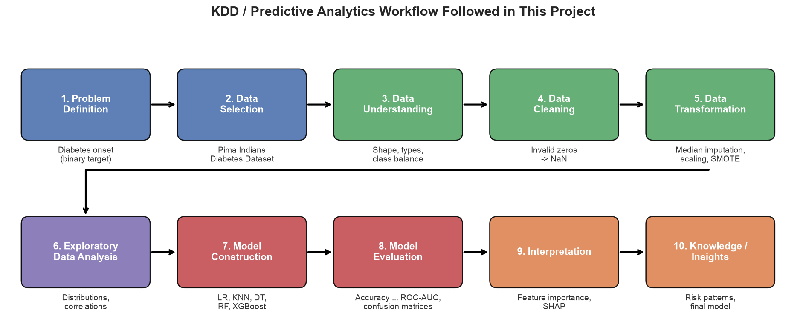
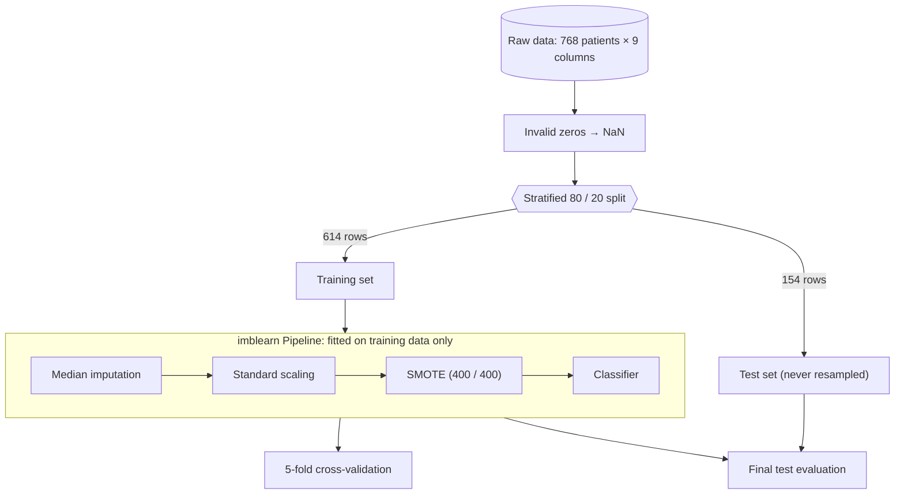
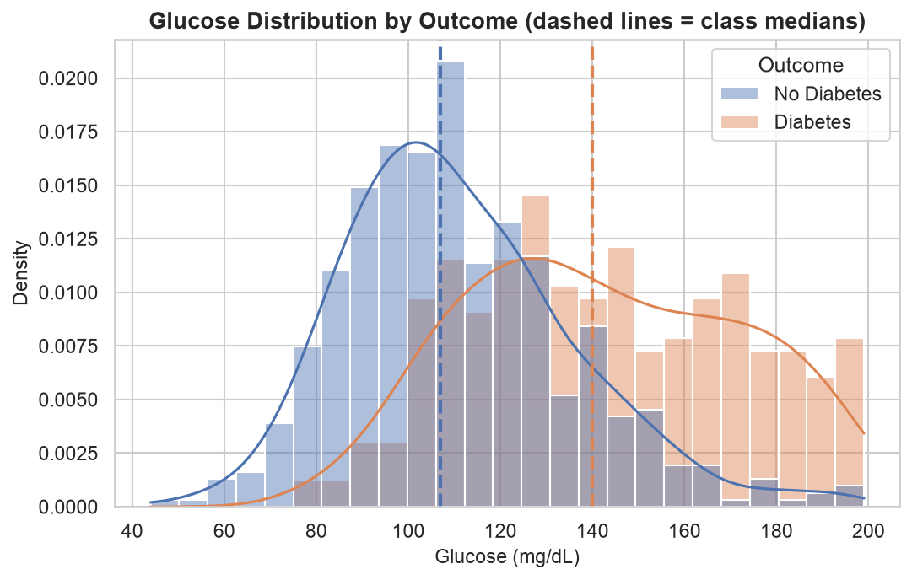
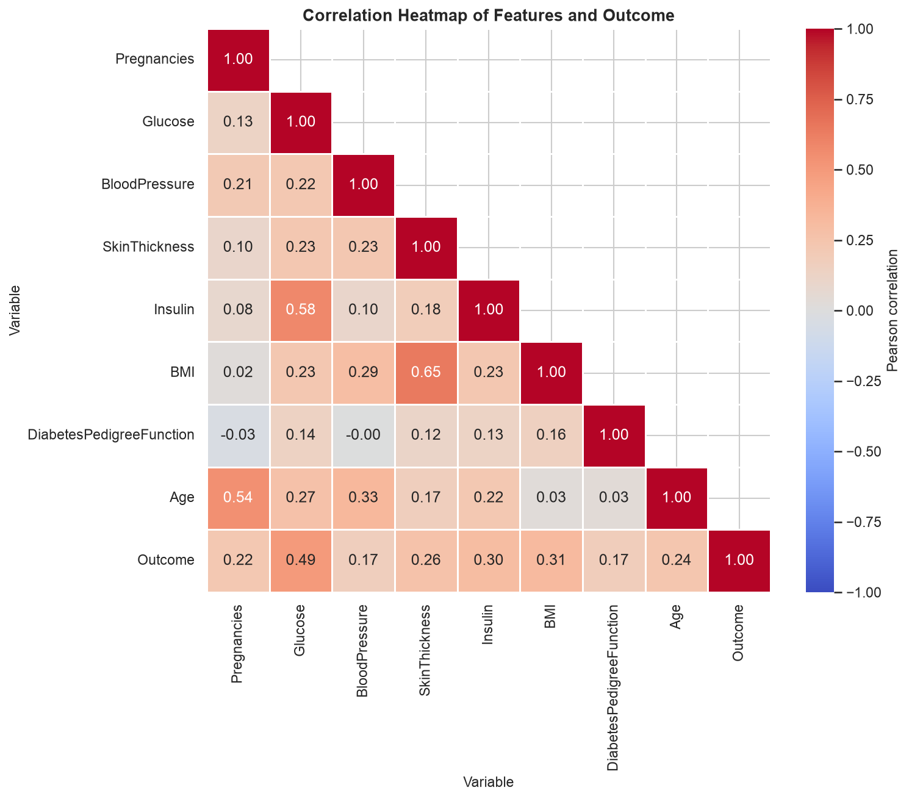
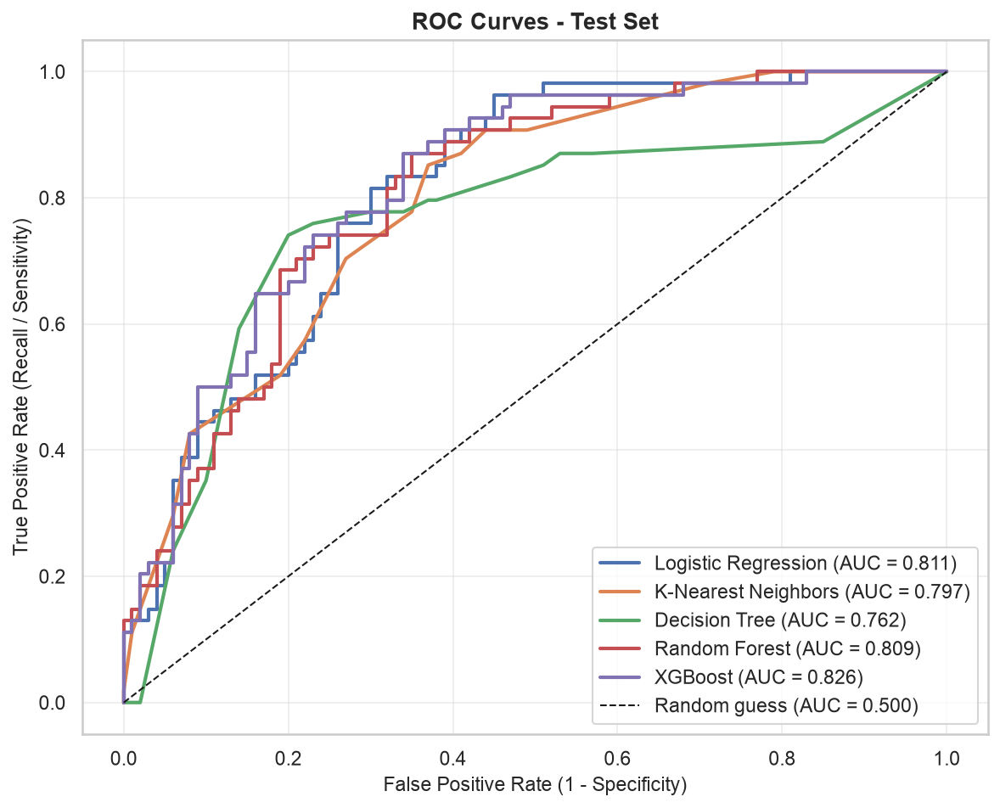
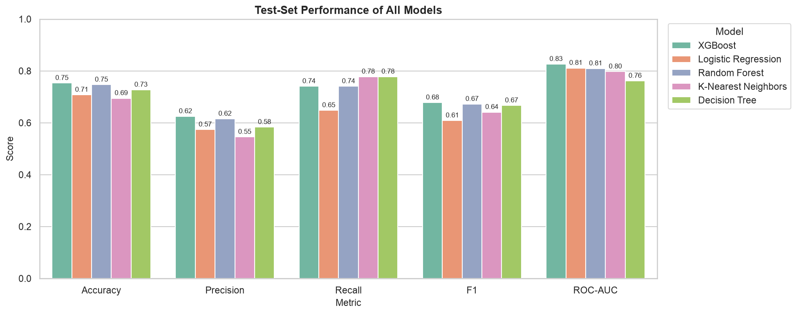
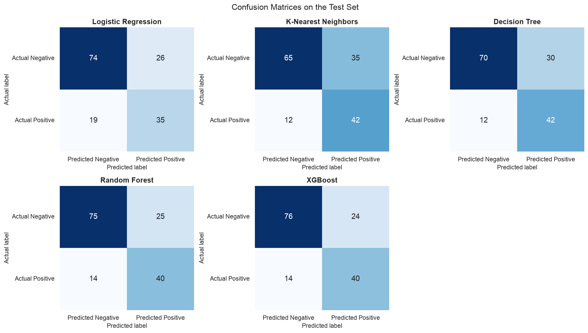
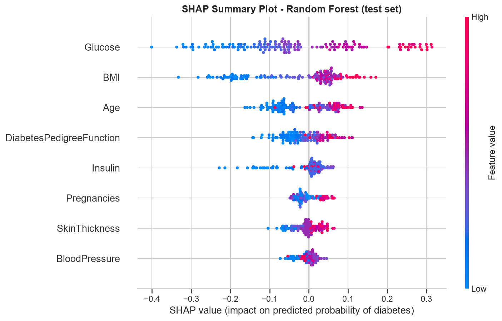

<div align="center">

# 🩺 Diabetes Onset Prediction Using Machine Learning

**An end-to-end Predictive Analytics / KDD project that estimates diabetes risk from routine diagnostic measurements**

[](https://www.python.org/)
[](notebooks/Diabetes_Onset_Prediction.ipynb)
[](https://scikit-learn.org/)
[](https://xgboost.readthedocs.io/)
[](https://shap.readthedocs.io/)
[](https://imbalanced-learn.org/)
[](LICENSE)

**Hardik Jain** · Student ID **23070521056** · Predictive Analytics (CA-3)

</div>

> [!IMPORTANT]
> This is an **academic project**. The model is **not** a medical diagnostic system and must not be used to make clinical decisions.

---

## ⚡ At a Glance

| | |
|---|---|
| 🎯 **Task** | Binary classification: will a patient have diabetes (Outcome = 1) or not (Outcome = 0)? |
| 📊 **Data** | Pima Indians Diabetes Dataset: 768 patients, 8 diagnostic features, 35 % diabetic |
| 🧹 **Key challenge** | Hidden missing values encoded as impossible **zeros** (Insulin 48.7 %, SkinThickness 29.6 %) and class imbalance |
| 🛡️ **Method** | Leak-free pipeline: median imputation → scaling → SMOTE (training data only) → classifier |
| 🤖 **Models** | Logistic Regression · KNN · Decision Tree · Random Forest · XGBoost |
| 🏆 **Final model** | **Random Forest**: recall **0.741**, ROC-AUC **0.809** on the held-out test set (cross-validated ROC-AUC **0.829**) |
| 🔍 **Top predictor** | **Glucose**, followed by BMI, Age and Diabetes Pedigree Function (confirmed by SHAP) |

<p align="center">
  
</p>

---

## 📑 Table of Contents

- [Deliverables](#-deliverables)
- [Problem Statement & Objectives](#-problem-statement--objectives)
- [Dataset](#-dataset)
- [Methodology](#-methodology)
- [Exploratory Data Analysis](#-exploratory-data-analysis)
- [Models](#-models)
- [Results](#-results)
- [Model Interpretation](#-model-interpretation)
- [Try a Prediction](#-try-a-prediction)
- [Project Structure](#-project-structure)
- [Getting Started](#-getting-started)
- [Limitations & Future Scope](#-limitations--future-scope)
- [References](#-references)

---

## 📦 Deliverables

| Deliverable | File | Description |
|---|---|---|
| 📓 Jupyter Notebook | [`Diabetes_Onset_Prediction.ipynb`](notebooks/Diabetes_Onset_Prediction.ipynb) | Fully executed, 23 sections covering every KDD stage with explanations |
| 📄 Project Report | [`Diabetes_Onset_Prediction_Report.pdf`](reports/Diabetes_Onset_Prediction_Report.pdf) | 6 chapters: Introduction, Literature Review, Workflow, Results, Conclusion, References |
| 🎤 Presentation | [`Diabetes_Onset_Prediction_Presentation.md`](presentation/Diabetes_Onset_Prediction_Presentation.md) | 12 slides with speaker notes and viva preparation |
| 🧩 Source modules | [`src/`](src) | Reusable preprocessing, model and evaluation code |
| 📈 Results | [`results/`](results) | Metric tables (CSV) and 17 generated figures |

---

## 🎯 Problem Statement & Objectives

Type 2 diabetes often develops slowly and can go unnoticed for years, and late detection increases the risk of complications. Hospitals already record simple measurements such as plasma glucose, BMI and blood pressure.

> **Problem:** Given a patient's diagnostic measurements **X**, predict whether **Outcome = 1 (diabetes)** or **Outcome = 0 (no diabetes)**, and estimate the probability of diabetes, so that higher-risk individuals can be **flagged for proper clinical testing**.

**Objectives**

1. Identify and correct hidden data-quality problems.
2. Explore how each measurement relates to the outcome.
3. Build a reproducible pipeline that **never leaks test data into training**.
4. Compare five algorithms using metrics suited to an **imbalanced screening** problem.
5. Choose a final model with a transparent, recall-aware rule, not accuracy alone.
6. Explain the model's behaviour with **feature importance** and **SHAP**.

---

## 🗂 Dataset

**Pima Indians Diabetes Dataset.** It was originally collected by the US National Institute of Diabetes and Digestive and Kidney Diseases. All 768 subjects are females of Pima Indian heritage aged 21 or older.
Source: [jbrownlee/Datasets](https://github.com/jbrownlee/Datasets/blob/master/pima-indians-diabetes.data.csv), stored with a header row at [`data/pima-indians-diabetes.csv`](data/pima-indians-diabetes.csv). The observations themselves are unchanged.

| Feature | Description | Unit |
|---|---|---|
| Pregnancies | Number of times pregnant | count |
| Glucose | Plasma glucose, 2 h oral glucose tolerance test | mg/dL |
| BloodPressure | Diastolic blood pressure | mm Hg |
| SkinThickness | Triceps skin-fold thickness | mm |
| Insulin | 2-hour serum insulin | µU/mL |
| BMI | Body-mass index | kg/m² |
| DiabetesPedigreeFunction | Score of diabetes history in relatives | – |
| Age | Age | years |
| **Outcome** | **Target: 0 = no diabetes, 1 = diabetes** | class |

### 🧹 Hidden missing values

The raw file reports **no missing values**, but five columns contain physiologically impossible **zeros**. These are treated as missing (NaN):

| Feature | Invalid zeros | % of rows |
|---|---:|---:|
| Glucose | 5 | 0.65 % |
| BloodPressure | 35 | 4.56 % |
| SkinThickness | 227 | 29.56 % |
| Insulin | 374 | **48.70 %** |
| BMI | 11 | 1.43 % |

Dropping incomplete rows would discard almost half the data, so the missing values are **imputed with the training-set median** instead.

---

## 🛠 Methodology

The project follows the **KDD process**: Problem Definition → Data Selection → Data Understanding → Data Cleaning → Data Transformation → EDA → Model Construction → Evaluation → Interpretation → Knowledge.

### 🛡️ Leak-free modelling pipeline



**Why this design?**

* **The split comes first.** Medians, scaling statistics and synthetic SMOTE samples are learned **only from training data**, so the test set stays truly unseen.
* **SMOTE sits inside the pipeline.** During cross-validation it is re-applied to each training fold only, never to the validation fold.
* **Imbalance handling pays off.** Without it, Logistic Regression's cross-validated recall drops to **0.57**. With SMOTE it rises to **0.72**, while ROC-AUC stays essentially the same.
* **Reproducible.** `random_state = 42` everywhere; repeated runs produce byte-identical results.

---

## 🔬 Exploratory Data Analysis

<p align="center">
  
  
</p>

| Insight | Evidence |
|---|---|
| 🍬 **Glucose separates the classes best** | Median 140 vs. 107 mg/dL; correlation with Outcome **0.49** |
| ⚖️ **BMI is higher in diabetic patients** | Median 34.3 vs. 30.1 kg/m²; r = 0.31 |
| 🎂 **Diabetic patients tend to be older** | Median age 36 vs. 27 years |
| 🔗 **Moderate feature correlations** | SkinThickness–BMI 0.65, Glucose–Insulin 0.58: no feature needs to be removed |
| 🌫️ **Every feature overlaps between classes** | No single measurement is enough, so a multivariate model is needed |

*These are statistical associations in this sample, not causal effects.*

---

## 🤖 Models

| Model | Paradigm | Configuration |
|---|---|---|
| Logistic Regression | Linear, interpretable baseline | `max_iter=1000` |
| K-Nearest Neighbors | Instance-based (distance) | `n_neighbors=15` |
| Decision Tree | Rule-based tree | `max_depth=5`, `min_samples_leaf=5` |
| Random Forest | Bagging ensemble | `n_estimators=300`, `min_samples_leaf=2` |
| XGBoost | Gradient boosting | `n_estimators=200`, `max_depth=3`, `learning_rate=0.05`, `subsample=0.8`, `colsample_bytree=0.8` |

All models are evaluated on **Accuracy, Precision, Recall, F1 and ROC-AUC**, plus specificity, confusion matrices and ROC curves.
**Recall** gets special attention: in screening, a missed diabetic patient (false negative) is costlier than a false alarm, which would lead to a follow-up test.

---

## 📊 Results

> All numbers below come from executing the notebook and are saved in [`results/model_comparison.csv`](results/model_comparison.csv) and [`results/metrics.csv`](results/metrics.csv).

### Hold-out test set (154 patients, sorted by ROC-AUC)

| Model | Accuracy | Precision | Recall | F1 | ROC-AUC |
|---|---:|---:|---:|---:|---:|
| XGBoost | 0.7532 | 0.6250 | 0.7407 | 0.6780 | 0.8263 |
| Logistic Regression | 0.7078 | 0.5738 | 0.6481 | 0.6087 | 0.8113 |
| 🏆 **Random Forest** | **0.7468** | **0.6154** | **0.7407** | **0.6723** | **0.8094** |
| K-Nearest Neighbors | 0.6948 | 0.5455 | 0.7778 | 0.6412 | 0.7974 |
| Decision Tree | 0.7273 | 0.5833 | 0.7778 | 0.6667 | 0.7616 |

<details>
<summary><b>5-fold cross-validation on the training set (mean ± std)</b></summary>

| Model | Accuracy | Precision | Recall | F1 | ROC-AUC |
|---|---:|---:|---:|---:|---:|
| Logistic Regression | 0.772 ± 0.015 | 0.658 ± 0.026 | 0.724 ± 0.045 | 0.689 ± 0.021 | 0.843 ± 0.020 |
| K-Nearest Neighbors | 0.728 ± 0.054 | 0.588 ± 0.070 | 0.790 ± 0.020 | 0.672 ± 0.047 | 0.820 ± 0.045 |
| Decision Tree | 0.697 ± 0.029 | 0.560 ± 0.047 | 0.687 ± 0.069 | 0.612 ± 0.013 | 0.762 ± 0.013 |
| Random Forest | 0.779 ± 0.009 | 0.672 ± 0.022 | 0.715 ± 0.028 | 0.692 ± 0.009 | 0.829 ± 0.025 |
| XGBoost | 0.751 ± 0.027 | 0.632 ± 0.041 | 0.687 ± 0.058 | 0.657 ± 0.040 | 0.822 ± 0.030 |

</details>

<p align="center">
  
  
</p>

### 🏆 Why Random Forest?

No single model wins every metric, so the final model was chosen with a **predefined, screening-oriented rule** instead of accuracy alone:

1. **Recall ≥ 0.70 in both cross-validation and the test set.** The model must reliably catch diabetic patients.
2. Among eligible models, pick the highest **average of all five metrics**, averaged over **cross-validation and test**. This rewards consistency, not one lucky split.

| Model | CV mean | Test mean | CV recall | Test recall | Overall | Eligible |
|---|---:|---:|---:|---:|---:|:---:|
| **Random Forest** | 0.7374 | 0.7169 | 0.715 | 0.741 | **0.7272** | ✅ |
| XGBoost | 0.7096 | 0.7246 | 0.687 | 0.741 | 0.7171 | ❌ |
| K-Nearest Neighbors | 0.7196 | 0.6913 | 0.790 | 0.778 | 0.7054 | ✅ |
| Logistic Regression | 0.7372 | 0.6699 | 0.724 | 0.648 | 0.7036 | ❌ |
| Decision Tree | 0.6637 | 0.7033 | 0.687 | 0.778 | 0.6835 | ❌ |

* **XGBoost** had the best *test* scores, but its cross-validated recall (0.687) missed the threshold.
* **Logistic Regression** was best in cross-validation but had the lowest test recall (it missed 19 of 54 diabetic patients).
* **Random Forest** ranks first or second on most metrics in **both** evaluations. On the test set it catches **40 of 54** diabetic patients with **specificity 0.75**.

<p align="center">
  
</p>

---

## 🔍 Model Interpretation

<p align="center">
  
</p>

| Feature | Random Forest importance | Mean \|SHAP\| | Higher value pushes prediction |
|---|---:|---:|---|
| **Glucose** | 0.276 | 0.146 | ⬆️ toward diabetes |
| **BMI** | 0.175 | 0.094 | ⬆️ toward diabetes |
| **Age** | 0.126 | 0.065 | ⬆️ toward diabetes |
| **DiabetesPedigreeFunction** | 0.111 | 0.043 | ⬆️ toward diabetes |
| Insulin | 0.089 | 0.034 | low values push strongly toward *no* diabetes |
| BloodPressure | 0.076 | 0.015 | weak / mixed |

**Key takeaways**

* **Glucose dominates** in every view: EDA, correlations, logistic-regression coefficients, impurity importance and SHAP. High glucose can raise the predicted probability by up to about **30 percentage points**.
* **BMI, Age and family history (pedigree function)** form the next tier of predictors, consistent with published work on this dataset.
* Four independent interpretation methods agree, which makes the ranking trustworthy. It still describes **how the model uses the data**, not medical causation.

---

## 🧪 Try a Prediction

The notebook defines `predict_diabetes()`, which applies the same cleaning rule and the fitted final pipeline to a single patient:

```python
predict_diabetes(Pregnancies=6, Glucose=168, BloodPressure=74, SkinThickness=35,
                 Insulin=200, BMI=38.2, DiabetesPedigreeFunction=0.85, Age=50)
```

```text
Predicted class: Diabetes likely (1)
Probability of diabetes: 87.2%
Note: academic ML demonstration - NOT a medical diagnosis.
```

| Example patient | Glucose | BMI | Age | Prediction | P(diabetes) |
|---|---:|---:|---:|---|---:|
| A | 168 | 38.2 | 50 | Diabetes likely | 87.2 % |
| B | 89 | 24.5 | 24 | Diabetes unlikely | 1.7 % |
| C (Insulin and SkinThickness not measured) | 130 | 32.0 | 35 | Diabetes likely | 66.7 % |

---

## 📁 Project Structure

```
├── README.md
├── requirements.txt
├── LICENSE
├── .gitignore
├── data/
│   └── pima-indians-diabetes.csv            # dataset with header row (768 × 9)
├── notebooks/
│   └── Diabetes_Onset_Prediction.ipynb      # main, fully executed notebook
├── src/
│   ├── preprocessing.py                     # loading, invalid-zero handling, split, imputer/scaler
│   ├── models.py                            # model definitions, SMOTE pipelines, cross-validation
│   └── evaluation.py                        # metrics, confusion matrices, ROC curves
├── reports/
│   └── Diabetes_Onset_Prediction_Report.pdf # academic project report
├── presentation/
│   └── Diabetes_Onset_Prediction_Presentation.md  # 12 slides + speaker notes
└── results/
    ├── figures/                             # 17 figures generated by the notebook
    ├── model_comparison.csv                 # main metric table (test set)
    └── metrics.csv                          # detailed metrics incl. confusion counts and CV scores
```

---

## 🚀 Getting Started

**1. Clone and install** (Python 3.10 or newer)

```bash
git clone https://github.com/hardikjain2005/-Predictive-Analytics-CA-3-Diabetes-Onset-Prediction-Using-Machine-Learning.git diabetes-onset-prediction
cd diabetes-onset-prediction
python3 -m venv .venv
source .venv/bin/activate        # Windows: .venv\Scripts\activate
pip install -r requirements.txt
```

**2. Run the notebook**

```bash
jupyter notebook notebooks/Diabetes_Onset_Prediction.ipynb     # then: Kernel → Restart & Run All
```

or re-execute every cell non-interactively, which also regenerates all figures and CSV files:

```bash
jupyter nbconvert --to notebook --execute --inplace notebooks/Diabetes_Onset_Prediction.ipynb
```

The full run takes under a minute on a laptop. If `data/pima-indians-diabetes.csv` is missing, the notebook downloads it automatically.

> [!NOTE]
> Results were produced with Python 3.13, pandas 3.0.6, NumPy 2.5.3, scikit-learn 1.9.1, imbalanced-learn 0.14.2, XGBoost 3.4.1 and SHAP 0.53.0. Other library versions may give slightly different numbers.

**Tech stack:** Python · pandas · NumPy · Matplotlib · Seaborn · scikit-learn · imbalanced-learn · XGBoost · SHAP · Jupyter

---

## 🚧 Limitations & Future Scope

| Limitations | Future scope |
|---|---|
| Small dataset (768 patients; 154 in the test set), so metrics carry real uncertainty | Larger, more diverse and more recent datasets |
| Narrow demographics: Pima Indian women aged 21 or older | External validation on other populations and hospitals |
| Heavy missingness in Insulin and SkinThickness, filled by median imputation | Additional clinical features such as HbA1c |
| SMOTE samples are synthetic, not real patients | Cross-validated / nested hyperparameter tuning |
| Fixed 0.5 threshold and uncalibrated probabilities | Probability calibration and cost-sensitive threshold selection |
| No external validation; prediction ≠ diagnosis | Per-patient SHAP explanations, a screening-support deployment and drift monitoring |

---

## 📚 References

1. J. W. Smith *et al.*, "Using the ADAP learning algorithm to forecast the onset of diabetes mellitus," *Proc. Annu. Symp. Comput. Appl. Med. Care*, pp. 261–265, 1988.
2. N. V. Chawla *et al.*, "SMOTE: Synthetic minority over-sampling technique," *JAIR*, vol. 16, pp. 321–357, 2002.
3. L. Breiman, "Random forests," *Machine Learning*, vol. 45, no. 1, pp. 5–32, 2001.
4. T. Chen and C. Guestrin, "XGBoost: A scalable tree boosting system," *Proc. ACM SIGKDD*, pp. 785–794, 2016.
5. S. M. Lundberg and S.-I. Lee, "A unified approach to interpreting model predictions," *NeurIPS*, 2017.
6. R. D. Joshi and C. K. Dhakal, "Predicting type 2 diabetes using logistic regression and machine learning approaches," *IJERPH*, vol. 18, no. 14, art. 7346, 2021.

The complete list of 18 references, with a literature review, is in the [project report](reports/Diabetes_Onset_Prediction_Report.pdf).

---

## ⚖️ Disclaimer & License

This repository is an academic project for a Predictive Analytics course, intended for learning and research only. It is **not** a medical device or diagnostic system and has not been clinically validated. Always consult a qualified healthcare professional for medical advice.

Code is released under the [MIT License](LICENSE). The Pima Indians Diabetes Dataset is subject to the terms of its original providers.

<div align="center">

Made by **Hardik Jain** · Predictive Analytics

</div>
